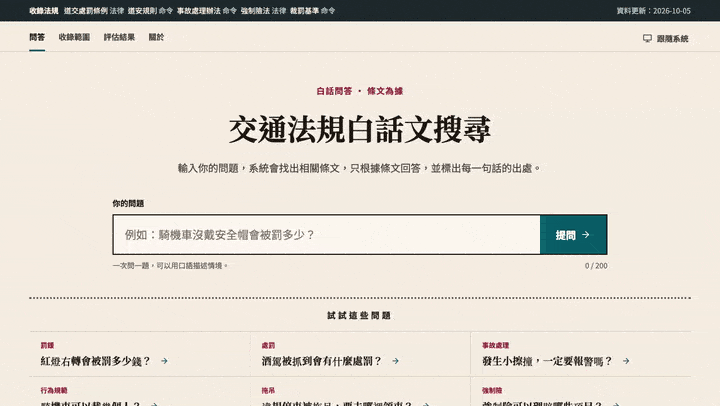
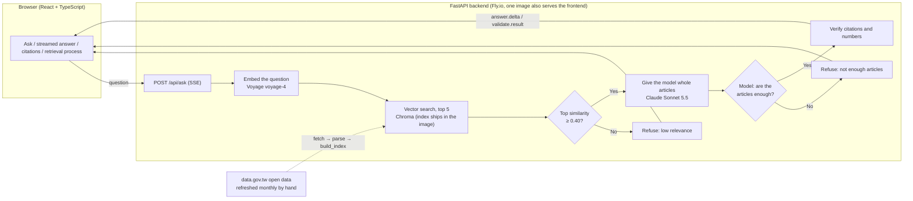

# Traffic Law RAG (交通法規資料庫)

**English** | [繁體中文](README.zh-TW.md)

[](https://github.com/leannechen/traffic-law-rag/actions/workflows/ci.yml)

Ask Taiwan's traffic laws in plain language. The system answers only from the statute text and cites the source of every claim. When it finds no basis, it refuses instead of guessing.



**Live demo: https://traffic-law-rag.fly.dev/** (the machine stops when nobody is using it, so the first visit takes about 6–7 seconds). The interface and the law texts are in Traditional Chinese.

## Problem

Asking an LLM a legal question with no scope limit tends to go wrong in two ways:

1. **Vocabulary gap**: statutes are written in formal legal language, but people ask in everyday speech.
2. **Plausible but wrong answers**: the answer sounds reasonable but does not match the current text, for example a citation of an article that does not exist, a wrong fine amount, or a confident answer about something the loaded laws do not cover.

This project aims to do three things:

1. **Answers have sources**: every claim is followed by an article number, and the full article text is one click away.
2. **Citations are verifiable**: the system checks that every cited article was actually retrieved for this question, and every amount in the answer must appear in the article it cites.
3. **"I don't know" is a valid answer**: for questions that are out of scope or not supported by the retrieved articles, it refuses and explains why.

| | Details |
|---|---|
| **Input** | One plain-language question (up to 200 characters) |
| **Output** | A streamed answer in Chinese with an article citation on every claim; evidence cards (retrieved articles with similarity scores); or a refusal with the reason |
| **Scope** | Five regulations (462 articles, about 489 chunks): the Act Governing the Punishment of Road Traffic Violations, the Road Traffic Safety Regulations, the Regulations for Handling Road Traffic Accidents, the Compulsory Automobile Liability Insurance Act, and the Standards for Fines and Handling of Road Traffic Violations |

> The fine tables attached to the "Standards for Fines" are not included: in the open data they exist only as file names with no content, so the system neither indexes them nor uses them as a source of amounts. See [ADR 0002](docs/decisions/0002-data-source.md).

## Architecture



One question produces these events in order (over SSE), and the "retrieval process" in the UI is drawn from them: rewrite the question → retrieve articles → relevance check → generate the answer → verify citations. Details in [ADR 0006](docs/decisions/0006-sse-api.md).

## Evaluation

The evaluation set has 40 questions: 28 answerable and 12 out of scope (7 of them deliberately close to the topic, such as "exam registration fee" and "parking lot charges"). Claude Code drafted the questions after reading the articles, and **I checked every gold answer (the correct articles and the key amounts) by hand against the original text.**

| Metric | Result | Meaning |
|---|---|---|
| Recall@5 | 1.000 | The top 5 retrieved results cover all gold articles |
| MRR | 0.845 | The first correct article ranks near the top on average (1.0 = always first) |
| Citation correctness | 1.000 | The answer cites at least one gold article |
| Citation precision | 0.653 | Share of cited articles that are gold articles (an extra citation is not necessarily wrong) |
| Number correctness | 1.000 | Every amount and period in the answer appears in the article it cites |
| Refusal correctness | 1.000 | 12/12 out-of-scope questions refused (6 stopped by the threshold, 6 by the model); 0/28 answerable questions wrongly refused |

Each question costs about US$0.012 with Sonnet 5.5 (measured on only 3 questions, so a rough estimate).

**How to read these numbers (caveats):**

- Only 28 questions are answerable, so one rank change moves MRR by several points. Treat this as directional evidence, not a precise value.
- The questions were written by someone who had read the articles, so their wording may be closer to the statutes than real users' wording, and the perfect Recall@5 may overstate real-world performance.
- The evaluation page of the live demo ("評估結果") shows this same result, and each question expands to its gold answer and top 5 retrieved items.

To reproduce:

```bash
cd backend
uv run python -m eval.run_eval --retriever vector --name baseline-vector     # retrieval
uv run python -m eval.run_generation_eval --name my-run                      # generation, citation, refusal (needs ANTHROPIC_API_KEY)
```

## Technical Trade-offs

Every decision has an ADR with the background, the options, and the reasoning. The ADRs are written in Traditional Chinese.

| Topic | Chosen | Rejected | Details |
|---|---|---|---|
| Data source | The data.gov.tw open-data bundle | Scraping the law database website (robots.txt forbids it, HTML changes often) | [ADR 0002](docs/decisions/0002-data-source.md) |
| Chunking | One chunk per article; split at paragraph and item boundaries only above 800 characters | Fixed-size sliding windows (a split chunk cannot be traced back to its article number) | [ADR 0003](docs/decisions/0003-chunking.md) |
| Vector store | Chroma, with the index shipped in the image | pgvector (only a few hundred chunks, no database service needed) | [ADR 0001](docs/decisions/0001-tech-stack.md), [0007](docs/decisions/0007-deployment.md) |
| Retrieval | Vector search only | Hybrid (vector + BM25): MRR 0.845 → 0.749, no improvement | [ADR 0004](docs/decisions/0004-retrieval.md) |
| Citations | Custom `[[article-id]]` markers, verified by the backend | Anthropic's native Citations (cannot be parsed while streaming, cannot apply our own validation rules) | [ADR 0005](docs/decisions/0005-generation.md) |
| Refusal | Two layers: similarity threshold 0.40 plus a model judgment | A single threshold alone (near-topic out-of-scope questions score like answerable ones) | [ADR 0004](docs/decisions/0004-retrieval.md), [0005](docs/decisions/0005-generation.md) |
| Streaming | SSE, with the question sent by POST | WebSocket (two-way is not needed), `EventSource` (cannot POST) | [ADR 0006](docs/decisions/0006-sse-api.md) |
| Deployment | One Fly.io machine that stops when idle | Several machines or always-on (rate limits live in memory; always-on costs more) | [ADR 0007](docs/decisions/0007-deployment.md) |

## Challenges and Solutions

- **A single similarity threshold cannot separate near-topic out-of-scope questions.** After adding 8 questions close to the boundary, the top similarity of out-of-scope questions (up to 0.618) overlapped with that of answerable ones (down to 0.416), so any threshold either wrongly refuses or wrongly lets through. The threshold (0.40) now only blocks clearly unrelated questions, and the model decides the near-topic ones after reading the articles.
- **A question I had labeled "out of scope" was overturned by the model.** For q40 ("How often should a car be serviced?") I had searched only for "汽車保養" and missed "保養"; the model answered from Article 39-3 of the Road Traffic Safety Regulations, and it was right. I relabeled the question as answerable and noted the lesson: when checking that the laws contain nothing, search for the topic word, not only the full phrase.
- **Giving the model only the retrieved chunk misses the other paragraphs of the same article.** After switching to whole articles, key-amount coverage went from 0.894 to 0.985 and out-of-scope refusals from 12/13 to 12/12 (the evaluation set differed by one label before and after; see ADR 0005).
- **Cold start was too slow.** The first request after the machine stopped took about 9.7 seconds. Most of that was Python compiling code at startup, so I precompile `.pyc` files when building the image (`UV_COMPILE_BYTECODE=1`), which brought it down to about 6.5 seconds (each measured once).

## Limitations and Next Steps

- **Data is not real-time**: it is refreshed by hand once a month, so a freshly amended law can lag by up to a month. The UI shows the data date (`data_version`).
- **No fine tables**: the tables attached to the Standards for Fines have no content, so questions that depend on them are refused or can only cite the parent act.
- **The evaluation set is small and written by us**: see "How to read these numbers" above.
- **Metrics come from one model and one run**: the sampling parameters cannot be made deterministic, so rerunning a question may give slightly different results.
- **Vector search only**: no reranker, and no stop-word handling for hybrid search.
- **Abuse protection relies on quotas**: 10 requests per minute per IP, 300 per day for the whole site (resets on restart), and a US$10 spend cap at each of the two providers. There is no passcode or Turnstile yet.
- **Next**: a reranker, adding the fine tables (they must be downloaded by hand; no scraper), showing the retrieval process as a node graph (the approved design uses a step list), and extending the evaluation set to real users' phrasing.

## How This Was Built

I built this with Claude Code (most commits carry a `Co-Authored-By` trailer). The work followed a written, step-by-step spec ([docs/archive/implementation-spec.md](docs/archive/implementation-spec.md)): 13 steps, each with acceptance criteria and its own commit. I kept the split of responsibility explicit:

- **AI**: wrote most of the code and tests, drafted the evaluation questions, and drafted documentation. A separate read-only reviewer agent ([.claude/agents/code-reviewer.md](.claude/agents/code-reviewer.md)) checked finished steps against the spec.
- **Me**: chose the scope and the data source, checked every expected answer in the evaluation set against the original law text by hand, made the trade-off decisions recorded in the ADRs, accepted each step before the next one started, rewrote the README, and ran the deployment with my own accounts.
- **What guards the backend**: I did not read it line by line. Automated tests (311 backend, 117 frontend unit, 14 end-to-end), the evaluation metrics, and CI are the gate. After any change to chunking, retrieval parameters, the threshold or the prompt, the evaluation is rerun and the before and after numbers are compared.
- **A known weakness**: because an AI that had read the articles drafted the questions, their wording may sit closer to the law than real users' wording. That can inflate Recall@5 (see [ADR 0004](docs/decisions/0004-retrieval.md)).

## Disclaimer and Data Source

- This system is **not legal advice**. Answers are generated by a model from the retrieved articles and may be wrong. For actual penalties and procedures, rely on the current text published in the [Laws & Regulations Database of the Republic of China](https://law.moj.gov.tw/) and on the competent authority's guidance.
- The statute text comes from the "Laws & Regulations Database" open data on [Taiwan's Open Government Data platform](https://data.gov.tw/) (laws: 18289, orders: 18290), licensed under the [Open Government Data License, version 1.0](https://data.gov.tw/license). This project does not scrape any page of law.moj.gov.tw.

---

## Quick Start

```bash
cp .env.example .env            # fill in ANTHROPIC_API_KEY and VOYAGE_API_KEY
docker compose up --build       # frontend http://localhost:5173, backend http://localhost:8010
```

On the first run you need to build the index first (see "Monthly Data Refresh" below). `data/index/` is not in version control.

## Testing

```bash
# Backend (in backend/)
uv run pytest

# Frontend unit tests (in frontend/)
pnpm test

# Frontend E2E (in frontend/): Playwright drives a real browser
pnpm exec playwright install chromium   # first time only
pnpm e2e                                # run all; add --ui for interactive mode
```

E2E starts the frontend and a fake backend by itself (`backend/tests/e2e_server.py`; the model, retrieval and article texts are all fake data), so it needs no API keys or index. CI runs E2E only on pushes to main.

## Deployment (Fly.io)

One image, with the backend also serving the frontend (see [ADR 0007](docs/decisions/0007-deployment.md)).

**Deploys are automatic.** A push to `main` that passes CI deploys to Fly.io (see [ADR 0008](docs/decisions/0008-continuous-deployment.md)). The search index is not in git; it is downloaded from the latest `data-*` GitHub Release. Pushes that only touch docs, CI config or tests skip the deploy, because a deploy restarts the machine and resets the in-memory quotas.

Manual deploy, for the first setup or as a fallback:

```bash
# First time
fly launch --no-deploy --copy-config
fly secrets set ANTHROPIC_API_KEY=... VOYAGE_API_KEY=...
# Manual deploy (needs data/index/ locally)
fly deploy --ha=false      # must be a single machine: the rate limit and daily quota live in memory, so two machines would count separately
```

### Monthly Data Refresh

The law data comes from data.gov.tw and is refreshed by hand once a month (in `backend/`):

```bash
uv run python -m app.ingestion.fetch          # download
uv run python -m app.ingestion.parse          # parse
uv run python -m app.ingestion.build_index    # rebuild the index (needs VOYAGE_API_KEY)
uv run python -m eval.run_generation_eval --name <name> --publish   # optional: update the evaluation page
# back in the repo root: publish the new index as a GitHub Release, then deploy
# (publish commands are in docs/operations.md; deploy via Actions → Run workflow, or fly deploy --ha=false)
```

### Cold Start and Cost

| Item | Number | Source |
|---|---|---|
| Container start until `/api/health` responds | about 2.5 s | Measured with local Docker |
| First question right after the container starts | about 4.5 s (includes loading the index) | Measured with local Docker |
| Fly machine waking from stop | The first request is answered after about 6.5 s (the machine is reachable after about 2.3 s), and the first question after that takes about 4 s. The machine stops after about 6 minutes without traffic. Before precompiling `.pyc` it was about 9.7 s (about 8.1 s on the machine side). Each measured once | Measured on Fly.io, from Taiwan |
| Runtime memory | about 200 MB (512 MB configured) | Measured with local Docker |
| Hosting cost | About US$3.69/month always-on (`shared-cpu-1x`, 512 MB, billed per second). With `auto_stop`, a stopped machine incurs no compute charge, only storage (US$0.15/GB/month; the image is about 0.66 GB, so about US$0.10/month) | [Fly.io pricing](https://docs.fly.io/about/pricing) |
| Model price | Sonnet 5.5: US$2 per million input tokens, US$10 per million output tokens | Anthropic pricing page |
| Embedding price | Voyage: US$0.06 per million tokens; each question embeds one short sentence, so it is negligible | [Voyage pricing](https://docs.voyageai.com/docs/pricing) |
| Model cost per question | About US$0.006–0.019, average about US$0.012 over three questions (2.3k–6.2k input and 134–653 output tokens, converted at the prices above); only 3 questions measured, so a rough estimate | Measured locally (the backend logs one `usage` line per question) |

## More Docs

- Development and test commands: [CLAUDE.md](CLAUDE.md)
- Implementation spec (archived, written before the build): [docs/archive/implementation-spec.md](docs/archive/implementation-spec.md)
- Technical decisions: [docs/decisions/](docs/decisions/)
- Operations manual (deploy, logs, abuse protection): [docs/operations.md](docs/operations.md)
- Re-record the demo GIF: run `pnpm demo:record` in `frontend/` (needs ffmpeg and gifski)

The spec, ADRs and operations manual are in Traditional Chinese.
