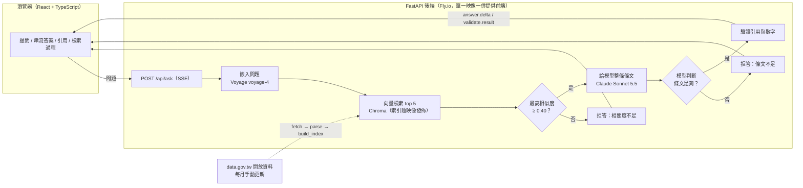

# 交通法規資料庫（Traffic Law RAG）

[English](README.md) | **繁體中文**

用白話問台灣交通法規，系統只根據條文回答，並標註每一句話的出處；找不到依據時，它會拒答，不會自己猜測。


**線上版：https://traffic-law-rag.fly.dev/**（沒人用時機器會停機，第一次開啟要等約 6–7 秒）

## 要解決的問題

當沒有特定限制範圍時，使用者對 LLM 詢問法律問題會遇到兩種狀況：
1. 用語落差：法律是用文言與專業用語寫的，但問題常是口語行文。
2. 容易得到看起來合理、卻對不上現行條文的答案：例如引用不存在的條號、金額記錯，或對法規沒有載入的事硬答。

這個專案想做到三件事：

1. **答案找得到出處**：每個論點後面都標註條號，點開可看整條原文。
2. **引用能被驗證**：系統會檢查答案引用的條文確實是這次檢索到的條文；答案裡的金額必須出現在它引用的條文。
3. **不知道就說不知道**：範圍外或條文不足的問題，明確拒答並說明原因。

|  | 內容 |
|---|---|
| **Input** | 一句白話問題（上限 200 字） |
| **Output** | 串流的中文答案，每句附 `[條號]` 引用；依據卡片（檢索到的條文與相似度）；或拒答說明 |
| **收錄範圍** | 道路交通管理處罰條例、道路交通安全規則、道路交通事故處理辦法、強制汽車責任保險法、違反道路交通管理事件統一裁罰基準及處理細則（共 5 部，462 條，約 489 個 chunk） |

> 「統一裁罰基準」的附表（各違規行為的罰款表）在開放資料裡只有檔名、沒有內容，所以系統不收錄附表，也不會把它當金額來源。見 [ADR 0002](docs/decisions/0002-data-source.md)。


## 架構



一次提問會依序送出這些事件（SSE），前端的「檢索過程」就是照這些事件畫的：改寫問題 → 檢索條文 → 相關度檢查 → 產生答案 → 驗證引用。細節見 [ADR 0006](docs/decisions/0006-sse-api.md)。


## 評估結果與方法

評估集共 40 題：28 題可回答、12 題範圍外（其中 7 題刻意貼近主題，例如「考照報名費」「停車場收費」）。題目由 Claude Code 讀條文後擬稿，**標準答案（正確條文與重點金額）則是全部人工逐題對照原文確認**。

| 指標 | 結果 | 意思 |
|---|---|---|
| Recall@5 | 1.000 | 前 5 名檢索結果涵蓋所有標準答案條文 |
| MRR | 0.845 | 第一個正確條文平均排在很前面（1.0 = 永遠第一） |
| 引用正確率 | 1.000 | 答案至少引用一條標準答案條文 |
| 引用精確率 | 0.653 | 答案引用的條文中，屬於標準答案的比例（額外引用的條文不一定錯） |
| 數字正確率 | 1.000 | 答案中的金額、期限都能在它引用的條文找到 |
| 拒答正確率 | 1.000 | 範圍外 12/12 拒答（門檻擋 6、模型擋 6），可回答題 0/28 誤拒 |

每次提問約 US$0.012（Sonnet 5.5；只量了 3 題，是粗估）。

**怎麼看這些數字（限制）**：

- 只有 28 題可回答，一題的名次變動就會讓 MRR 動好幾個百分點；這是方向性的證據，不是精確值。
- 題目是讀過條文的人擬的，所以用詞可能會比真實使用者更貼近條文，Recall@5 的滿分可能高估真實表現。
- 評估頁（Demo 站的「評估結果」）顯示的就是這份結果，逐題可展開看標準答案與檢索前 5 筆。

重現：

```bash
cd backend
uv run python -m eval.run_eval --retriever vector --name baseline-vector     # 檢索
uv run python -m eval.run_generation_eval --name my-run                      # 生成、引用、拒答（需 ANTHROPIC_API_KEY）
```

## 技術取捨

每個決策都有一份對應的 ADR，描述背景、採用或放棄的選項與設計考量：

| 主題 | 採用                           | 放棄 | 詳見 |
|---|------------------------------|---|---|
| 資料來源 | data.gov.tw 開放資料打包檔          | 爬法規資料庫網頁（robots.txt 禁止、HTML 易變） | [ADR 0002](docs/decisions/0002-data-source.md) |
| Chunk 策略 | 一條一個 chunk，超過 800 字才依項、款的邊界切 | 固定長度滑動視窗（切開後對不回條號） | [ADR 0003](docs/decisions/0003-chunking.md) |
| 向量庫 | Chroma，索引隨映像發佈               | pgvector（資料只有數百個 chunk，不需要資料庫服務） | [ADR 0001](docs/decisions/0001-tech-stack.md)、[0007](docs/decisions/0007-deployment.md) |
| 檢索 | 純向量                          | hybrid（向量＋BM25）：MRR 0.845 → 0.749，沒有變好 | [ADR 0004](docs/decisions/0004-retrieval.md) |
| 引用 | 自訂 `[[條號]]` 標記，後端驗證          | Anthropic 原生 Citations（不能邊串流邊解析、不能套用自己的驗證規則） | [ADR 0005](docs/decisions/0005-generation.md) |
| 拒答 | 兩層：相似度門檻 0.40 加模型判斷          | 只用單一門檻（貼近主題的範圍外問題，分數與可回答題重疊） | [ADR 0004](docs/decisions/0004-retrieval.md)、[0005](docs/decisions/0005-generation.md) |
| 串流 | SSE，POST 帶問題                 | WebSocket（用不到雙向）、`EventSource`（不能 POST） | [ADR 0006](docs/decisions/0006-sse-api.md) |
| 部署 | Fly.io 單機，沒人用時自動停機           | 多機、常駐（速率限制存在記憶體；常駐要多付錢） | [ADR 0007](docs/decisions/0007-deployment.md) |

## 遇到的困難與解法
- **單一相似度門檻分不開貼近主題的範圍外問題。** 補了 8 題貼近邊界的題目後，範圍外題的第一名相似度（最高 0.618）與可回答題（最低 0.416）重疊，任何門檻都會誤拒或漏放。所以門檻只負責擋明顯無關的問題（0.40），貼近主題的交給模型看過條文後判斷。
- **原本標記「範圍外」答案被模型推翻。** q40「汽車多久要保養一次？」我當初只搜了「汽車保養」，漏搜「保養」；模型引用道安規則 39-3 條作答，是對的。我改標成可回答，並記下教訓：確認「法規沒有」時，要搜主題詞，不只搜完整詞組。
- **只給模型檢索到的那一塊，會漏掉同一條的其他項。** 改成給整條條文後，重點金額涵蓋率 0.894 → 0.985，範圍外拒答 12/13 → 12/12（修正前後的評估集有一題標籤差異，見 ADR 0005）。
- **冷啟動太慢。** 機器停機後第一個請求約 9.7 秒。大部分時間花在啟動 Python 時編譯程式碼，所以在建映像時就預編譯 `.pyc`（`UV_COMPILE_BYTECODE=1`），降到約 6.5 秒（各只量 1 次）。

## 限制與後續方向

- **資料不即時**：每月手動更新一次，法規剛修正時最多落後一個月；畫面標示資料日期（`data_version`）。
- **不含附表**：統一裁罰基準的罰款附表沒有內容，涉及該表的金額問題會拒答或只能引用母法。
- **評估集小且由我們自己擬題**：見上方「怎麼看這些數字」。
- **單一模型、單次執行的指標**：取樣參數無法設成確定性，同一題重跑可能略有不同。
- **只有純向量**：沒做 reranker、停用詞處理的 hybrid。
- **防濫用靠額度**：每 IP 每分鐘 10 次、全站每日 300 次（重啟歸零）、兩家服務商各設 US$10 花費上限；尚未做通關碼或 Turnstile。
- **後續**：reranker、補上裁罰基準附表（需人工下載，不寫爬蟲）、改用節點圖呈現檢索過程（設計稿目前採用步驟列）、評估集擴充到真實使用者問法。

## 開發方式

這個專案是用 Claude Code 協作完成的（大多數 commit 有 `Co-Authored-By` 標註）。流程是照一份寫好的分步規格（[docs/archive/implementation-spec.md](docs/archive/implementation-spec.md)）進行：13 個步驟，每步有驗收條件、各自一個 commit。分工如下：

- **AI**：寫大部分的程式與測試、擬評估題目、起草文件。另有一個唯讀的 reviewer agent（[.claude/agents/code-reviewer.md](.claude/agents/code-reviewer.md)）在每步完成後，對照規格檢查。
- **我**：決定範圍與資料來源、把評估集的每一題標準答案逐題對照法規原文確認、做 ADR 裡的取捨決定、每一步驗收通過才進下一步、改寫 README，並用自己的帳號完成部署。
- **後端怎麼把關**：我沒有逐行看後端程式碼，靠自動化測試（後端 311 個、前端單元 117 個、端對端 14 個）、評估指標與 CI。改動 chunking、檢索參數、門檻或 prompt 之後，一定重跑評估並比較前後數字。
- **已知的弱點**：題目是讀過條文的 AI 擬的，措辭可能比真實使用者更接近條文，Recall@5 可能因此偏高（見 [ADR 0004](docs/decisions/0004-retrieval.md)）。

## 免責聲明與資料來源

- 本系統**不是法律意見**。答案由模型根據檢索到的條文產生，可能有誤；實際罰則與程序請以[全國法規資料庫](https://law.moj.gov.tw/)公告的現行條文與主管機關說明為準。
- 法規條文來自[政府資料開放平臺](https://data.gov.tw/)的「全國法規資料庫」開放資料（法律 18289、命令 18290），授權為[政府資料開放授權條款－第 1 版](https://data.gov.tw/license)。本專案不抓取 law.moj.gov.tw 的網頁。

---

## 快速開始

```bash
cp .env.example .env            # 填入 ANTHROPIC_API_KEY、VOYAGE_API_KEY
docker compose up --build       # 前端 http://localhost:5173、後端 http://localhost:8010
```

第一次需要先建索引（見下方「每月更新資料」）；`data/index/` 不進版控。

## 測試

```bash
# 後端（在 backend/）
uv run pytest

# 前端單元測試（在 frontend/）
pnpm test

# 前端 E2E（在 frontend/）：Playwright 驅動真實瀏覽器
pnpm exec playwright install chromium   # 首次才需要
pnpm e2e                                # 跑全部；加 --ui 開互動模式
```

E2E 會自己啟動前端與一個假後端（`backend/tests/e2e_server.py`，模型、檢索、條文都是假資料），不需要 API 金鑰或索引。CI 只在 push 到 main 時跑 E2E。

## 部署（Fly.io）

單一映像，後端一併提供前端（見 [ADR 0007](docs/decisions/0007-deployment.md)）。

**部署是自動的**：push 到 `main` 且 CI 通過後，會自動部署到 Fly.io（見 [ADR 0008](docs/decisions/0008-continuous-deployment.md)）。索引不在 git 裡，而是從最新的 `data-*` GitHub Release 下載。只改文件、CI 設定或測試的 push 不會部署，因為部署會重啟機器，記憶體裡的額度會歸零。

手動部署（首次設定或備援）：

```bash
# 首次
fly launch --no-deploy --copy-config
fly secrets set ANTHROPIC_API_KEY=... VOYAGE_API_KEY=...
# 手動部署（需要本機有 data/index/）
fly deploy --ha=false      # 一定要單機：速率限制與每日額度存在記憶體，兩台會各算各的
```

### 每月更新資料

法規資料來自 data.gov.tw，手動每月更新一次（在 `backend/`）：

```bash
uv run python -m app.ingestion.fetch          # 下載
uv run python -m app.ingestion.parse          # 解析
uv run python -m app.ingestion.build_index    # 重建索引（需要 VOYAGE_API_KEY）
uv run python -m eval.run_generation_eval --name <檔名> --publish   # 選用：更新評估頁
# 回到 repo 根目錄：把新索引發佈成 GitHub Release，再部署
# （發佈指令見 docs/operations.md；部署可用 Actions → Run workflow，或 fly deploy --ha=false）
```

### 冷啟動與成本

| 項目 | 數字 | 來源 |
|---|---|---|
| 容器啟動到 `/api/health` 可用 | 約 2.5 秒 | 本機 Docker 實測 |
| 容器剛啟動後第一次提問 | 約 4.5 秒（含載入索引） | 本機 Docker 實測 |
| Fly 機器從停機喚醒 | 第一個請求約 6.5 秒才回應（機器端「可連線」約 2.3 秒），之後第一次提問約 4 秒；停機約在 6 分鐘沒流量後發生。映像預編譯 `.pyc` 之前是約 9.7 秒（機器端約 8.1 秒）。各只量 1 次 | Fly.io 實測，來源：台灣 |
| 執行時記憶體 | 約 200 MB（設定 512 MB） | 本機 Docker 實測 |
| 主機費用 | 常駐約 US$3.69／月（`shared-cpu-1x` 512 MB，按秒計費）；`auto_stop` 沒流量時機器不計運算費，只剩儲存費（US$0.15／GB／月，映像約 0.66 GB，約 US$0.10／月） | [Fly.io pricing](https://docs.fly.io/about/pricing) |
| 模型單價 | Sonnet 5.5：輸入 US$2／百萬 token、輸出 US$10／百萬 token | Anthropic 價目頁 |
| Embedding 單價 | Voyage：US$0.06／百萬 token；每次提問只嵌入一句短問題，可忽略 | [Voyage pricing](https://docs.voyageai.com/docs/pricing) |
| 每次提問的模型費用 | 約 US$0.006–0.019，三題平均約 US$0.012（輸入 2.3k–6.2k、輸出 134–653 token，依單價換算）；只量了 3 題，是粗估 | 本機實測（後端會在 log 記 `usage` 一行） |

## 更多文件

- 開發與測試指令：[CLAUDE.md](CLAUDE.md)
- 實作規格（封存，開工前寫的）：[docs/archive/implementation-spec.md](docs/archive/implementation-spec.md)
- 技術決策：[docs/decisions/](docs/decisions/)
- 維運手冊（部署、log、防濫用）：[docs/operations.md](docs/operations.md)
- 重錄 demo GIF：在 `frontend/` 執行 `pnpm demo:record`（需要 ffmpeg 與 gifski）
